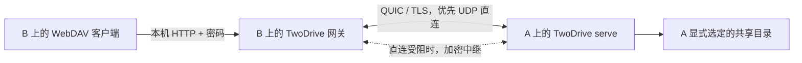

# Development 更新与发行准备 / Updates and distribution preparation

2026-10-15。开发基线 `dev` 47e264f；已下载并校验 Development 0.1.4 和稳定版 0.2.14-1。验证结果见文末及[故障记录](incidents.md)。

## 两台普通电脑的连接



A、B 都运行 TwoDrive 传输程序。最新 `dev` 的桌面上，A 打开“共享”，选择目录、点击“启动共享 → 导出连接文件”，通过可信渠道传给 B。B 在“连接 → 添加连接 → 从 TwoDrive 连接文件添加”中选择文件并“保存并连接”，程序自动启动网关。后续用原状态目录重连，不必反复邀请。发现局域网设备是可选步骤，不是授权步骤。命令行 `serve` 仍保留；桌面共享功能晚于已发布的 0.1.4。

如果 B 使用第三方 WebDAV 客户端，则先运行 `twodrive-dev --state <B的私有目录> connect --ticket-file <邀请文件>`，再连接该命令输出的 `http://127.0.0.1:4918/` 和私有凭据文件中的用户名/密码。网关只监听 B 的回环接口；不能把 A 的 UDP 端口当作 WebDAV URL。首次配对后省略 `--ticket-file`，保持 A 的服务和 B 的网关运行。邀请十分钟有效、只能使用一次；需要写入时 A 显式加 `--write`。命令及邀请更新详见[中文共享指南](../experiments/twodrive-dev/README.zh-CN.md#两台机器快速配对)。

首次使用需要 A 选择共享目录和传递一次邀请；双方桌面负责管理进程与网关。没有固定公网 IP 也可尝试打洞/中继，但两端须可达发现/中继基础设施；不能保证任何 NAT、校园网或防火墙都能 UDP 直连。本轮本机测试不能代表两台异地 NAT 主机的实际体验。共享 GUI 的范围见[验证记录](desktop-sharing-validation.md)。

In English: a third-party WebDAV client talks to a password-protected loopback
gateway on computer B. TwoDrive connects that gateway to computer A over
encrypted QUIC, with relay fallback. The desktop's PC/NAS provider starts the
gateway automatically after a one-time invitation. The latest dev desktop also
starts hosting and exports invitations from its Sharing page; `serve` remains
available for headless use. This GUI is newer than released Development 0.1.4.

## 自动检查更新

Development 桌面启动后异步检查 GitHub Releases，此后最多每 24 小时自动检查一次，偏好和最近尝试时间保存在私有状态目录的 `update-settings.json`。设置中可关闭检查或立即手动检查，发现更新时在主窗口显示提示和发布链接。离线、限流、无效响应不影响文件操作，也不会显示为“已是最新”。只读取公开发布元数据，不发送连接配置或令牌。

只识别 `dev-vX.Y.Z`，按数字比较版本并要求当前平台的发布包已上传；忽略草稿、稳定版 `v0.2.x` 和 `peer-v...`。发布地址由固定仓库和验证后的版本构造，不信任服务返回的任意链接。请求有超时和大小限制，最多读取三页各 100 条；若极端历史中 Development 发布被挤出该范围，将显示检查失败，需访问 Releases。后台检查不会阻塞引擎的文件请求队列。

这是一项检查/提示功能，不自动下载、执行或替换程序。MSIX 带有 `distribution-msix` 标记，通过分发渠道更新，应用内不检查 GitHub。普通便携版继续使用 GitHub 通道。

The update checker uses only the Development release channel, persists opt-out
and a 24-hour attempt interval, and offers a manual check. It never installs an
update. Network failures are separate from file/sync errors. MSIX distributions
defer updates to their distribution channel.

## MSIX

构建完整 Windows Development bundle 后运行：

```powershell
./scripts/build-msix.ps1 -Bundle apps/dav/build/windows/x64/runner/Release -TestPackage
```

脚本用已有云朵图标生成清单所需尺寸，保留完整 Flutter 数据、插件和两个 Rust 程序，声明 `runFullTrust` 与 Desktop VC Runtime 依赖，并使用 Windows SDK `MakeAppx` 执行校验和打包。输出 `dist/msix/*.msix` 与 SHA-256。测试包身份明确为 `TwoDrive.Development.Test`。

正式准备时从 Partner Center 取得 **Identity Name、Publisher、Publisher Display Name**，用 `-IdentityName`、`-Publisher`、`-PublisherDisplayName` 传入，不能沿用测试身份。商店版本四段、末段为 0；当前 pre-1.0 Development 映射为 `1.<minor>.<patch>.0`，可用 `-Version` 显式指定，发布后必须保持单调递增。正式上架还需商店名称、隐私政策、素材、完整权限说明、WACK、干净机器安装/升级/卸载与 OAuth/文件选择/子进程/托盘验证。仅打包成功不能证明认证成功。

MSIX 暂停使用便携版的自启动开关，避免保存随包升级失效的 WindowsApps 版本目录路径；后续须适配 Windows StartupTask。

The script produces a validated unsigned MSIX from the complete desktop bundle.
Partner Center identity is required for a real submission. Test identity packages
are not Store submissions. Store certification and packaged runtime validation
remain separate steps; do not distribute the unsigned test package as an installer.

依据：[Microsoft 手工打包说明](https://learn.microsoft.com/en-us/windows/msix/desktop/desktop-to-uwp-manual-conversion)、[商店包与版本要求](https://learn.microsoft.com/en-us/windows/apps/publish/publish-your-app/msix/app-package-requirements)。

## Debian / apt

仓库原有 `.deb` 是 GNOME OneDrive 客户端；本次标准化的是它，Flutter 桌面的发行版打包还需独立处理。`debian/control` 是唯一打包元数据来源；`scripts/build-deb.sh` 调用 `dpkg-buildpackage`，产物位于 `dist/debian/`。新增源码格式 `3.0 (quilt)`、DEP-5 版权、manpages、watch 和安装后 smoke；debhelper 生成 ELF/Python 依赖、校正权限、压缩文档。SQLite 使用系统库；安装不启动或启用用户服务。

构建前安装 `debian/README.source` 列出的依赖并显式 `cargo fetch --locked`。包构建和测试强制离线；缺依赖直接失败。这里提前填充的上游 Cargo 缓存只服务于准备阶段，**不是官方 archive build dependency**。进入 Debian 官方仓库还须将所需 Rust crate 纳入发行版、声明完整 `librust-*-dev` Build-Depends、使用 Debian cargo registry、补齐依赖版权审计，并通过 Debian unstable 的干净 sbuild、autopkgtest、piuparts 和维护者审核。当前 changelog 为 `UNRELEASED`。

apt 是包管理器，不存在统一的“apt 官方源”。如果目标是 Debian/Ubuntu 自带的软件仓库，需走对应发行版审核；如果只是便于用户 `apt install`，可以另建签名的项目仓库，但那不等于进入官方仓库。本次未提交 ITP、发送邮件或上传 Debian archive。

The Debian work standardizes the existing GNOME package, not the Flutter UI.
It remains preparation: Debian-packaged Rust dependencies, full copyright review,
clean distribution builds and sponsorship are required before official inclusion.
See [debian/README.source](../debian/README.source),
[Debian Policy](https://www.debian.org/doc/debian-policy/ch-source.html) and
[new-package procedure](https://www.debian.org/doc/manuals/developers-reference/pkgs.en.html#new-packages).

## 验证记录

- 本机 Windows：Development 37 个库测试与 7 个桌面引擎测试通过。
- Flutter 3.41.8 锁定依赖、analyze、30 项测试与 Windows release 构建通过；真实公开 GitHub 检查识别 Development 0.1.4。
- 本机 MSIX 通过 SDK 校验，输出 24,774,758 字节；后续下载原生 CI 的 MSIX（24,777,256 字节），校验 SHA-256、CRC、测试身份、未签名状态、更新通道标记与三个图标尺寸。保留的 33 个 bundle 文件逐一与同一 CI 的 Windows 便携目录比对哈希一致。
- 桌面 IPC 文件/备份测试及本机两个进程的 QUIC/UDP/WebDAV 传输通过。本机托盘 smoke 未获得前台焦点，原因仍未确认；独立 Windows CI 的重复展开、背景隐藏、位置稳定、外部焦点收起和 Escape 通知检查全部通过。后者是 Shell 通知模拟，不代替用户硬件点击验收。
- Debian 0.2.14-2 二进制包、调试包、quilt 源码包、实际依赖/权限检查、安装 smoke 和移除均通过。下载后重新核对 `.changes`、`.dsc` 两份清单及其引用文件的大小与 SHA-256，全部一致。二进制 Lintian 日志为空，源码无 E 级错误，仅保留 `newer-standards-version 4.7.4 (current is 4.6.2)`，来自 CI 旧版检查器。
- 尚未验证：商店提交/认证、签名安装后的全流程、Debian 官方依赖闭包及 sbuild、真实异地 NAT。

已核实源码提交：`f22a1213a360b095405087a63bb13250f673ce6a`。以下五组 CI 全部成功；后续收尾仅补充文档记录。精确产物大小、哈希和验证边界见[机器可读记录](distribution-validation-2026-10-15.json)。

| CI | 已通过的范围 |
| --- | --- |
| [TwoDrive desktop](https://github.com/LumiaBlack51/twodrive/actions/runs/38690583401) | Linux/Windows 桌面、Rust 65/59 项、Flutter 检查和构建、IPC/备份/自启动隔离、Windows 原生托盘及 MSIX |
| [Peer native builds](https://github.com/LumiaBlack51/twodrive/actions/runs/38690583553) | Linux/Windows 原生检查 |
| [WebDAV / QUIC](https://github.com/LumiaBlack51/twodrive/actions/runs/38690583461) | Linux/Windows 协议、双进程传输与原生检查 |
| [Windows dual preview](https://github.com/LumiaBlack51/twodrive/actions/runs/38690583597) | 既有 Windows 组合预览兼容性 |
| [Debian package](https://github.com/LumiaBlack51/twodrive/actions/runs/38690583450) | 离线构建/测试、旧包反例、完整上传清单、Lintian、安装/移除与源码归档 |

CI MSIX SHA-256：`8189e50a6ba4c0f6381228de3f72ead6479276874d978d98885066ee2dc6223f`；Debian 主包 SHA-256：`3ad1720c56d76eedbd16d7cc1a820294626d441e0c135618795fd545921b2c0e`。以上保留 PR #21 准备阶段的 CI 证据。后续 [Development 0.1.5](https://github.com/LumiaBlack51/twodrive/releases/tag/dev-v0.1.5) 已发布，最终产物哈希和 MSIX/Deb 实际安装验证见 Release 的 verification.json、runtime-validation.json 及 [0.1.5 说明](development-0.1.5.md)。
